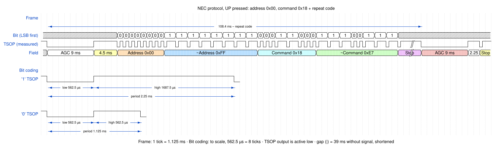
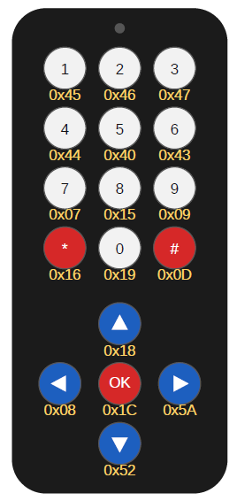

# NEC_HX1838_Profocoll_Info

Reference material for the **NEC infrared protocol** as used by the cheap 17-key
HX1838 remote control and IR receiver found in most Arduino kits. The repository
contains a protocol summary, a full code table, oscilloscope measurements of the
receiver output and WaveDrom timing diagrams.

It was made as course material for PB1180 *Programmable Logic Circuits*
(VHDL/FPGA) at USN, where students write a hardware NEC decoder, but the
information applies to any microcontroller or FPGA implementation.

## Remote control and code table

Address is `0x00` for all keys. The hex value under each key is its command code.

<table>
<tr>
<td valign="top"></td>
<td valign="top">

<table>
<tr><th>Key</th><th>Command</th><th>~Command</th><th>IRremote 2.x <code>results.value</code></th><th>IRremote 4.x <code>decodedRawData</code></th></tr>
<tr><td>1</td><td><code>0x45</code></td><td><code>0xBA</code></td><td><code>0x00FFA25D</code></td><td><code>0xBA45FF00</code></td></tr>
<tr><td>2</td><td><code>0x46</code></td><td><code>0xB9</code></td><td><code>0x00FF629D</code></td><td><code>0xB946FF00</code></td></tr>
<tr><td>3</td><td><code>0x47</code></td><td><code>0xB8</code></td><td><code>0x00FFE21D</code></td><td><code>0xB847FF00</code></td></tr>
<tr><td>4</td><td><code>0x44</code></td><td><code>0xBB</code></td><td><code>0x00FF22DD</code></td><td><code>0xBB44FF00</code></td></tr>
<tr><td>5</td><td><code>0x40</code></td><td><code>0xBF</code></td><td><code>0x00FF02FD</code></td><td><code>0xBF40FF00</code></td></tr>
<tr><td>6</td><td><code>0x43</code></td><td><code>0xBC</code></td><td><code>0x00FFC23D</code></td><td><code>0xBC43FF00</code></td></tr>
<tr><td>7</td><td><code>0x07</code></td><td><code>0xF8</code></td><td><code>0x00FFE01F</code></td><td><code>0xF807FF00</code></td></tr>
<tr><td>8</td><td><code>0x15</code></td><td><code>0xEA</code></td><td><code>0x00FFA857</code></td><td><code>0xEA15FF00</code></td></tr>
<tr><td>9</td><td><code>0x09</code></td><td><code>0xF6</code></td><td><code>0x00FF906F</code></td><td><code>0xF609FF00</code></td></tr>
<tr><td>*</td><td><code>0x16</code></td><td><code>0xE9</code></td><td><code>0x00FF6897</code></td><td><code>0xE916FF00</code></td></tr>
<tr><td>0</td><td><code>0x19</code></td><td><code>0xE6</code></td><td><code>0x00FF9867</code></td><td><code>0xE619FF00</code></td></tr>
<tr><td>#</td><td><code>0x0D</code></td><td><code>0xF2</code></td><td><code>0x00FFB04F</code></td><td><code>0xF20DFF00</code></td></tr>
<tr><td>UP</td><td><code>0x18</code></td><td><code>0xE7</code></td><td><code>0x00FF18E7</code></td><td><code>0xE718FF00</code></td></tr>
<tr><td>LEFT</td><td><code>0x08</code></td><td><code>0xF7</code></td><td><code>0x00FF10EF</code></td><td><code>0xF708FF00</code></td></tr>
<tr><td>OK</td><td><code>0x1C</code></td><td><code>0xE3</code></td><td><code>0x00FF38C7</code></td><td><code>0xE31CFF00</code></td></tr>
<tr><td>RIGHT</td><td><code>0x5A</code></td><td><code>0xA5</code></td><td><code>0x00FF5AA5</code></td><td><code>0xA55AFF00</code></td></tr>
<tr><td>DOWN</td><td><code>0x52</code></td><td><code>0xAD</code></td><td><code>0x00FF4AB5</code></td><td><code>0xAD52FF00</code></td></tr>
</table>

</td>
</tr>
</table>

UP (`0x18`) and 1 (`0x45`) are verified against the measurements in this
repository. The other codes are the standard values for this type of remote —
clones may differ, so check with your own receiver.

## Repository contents

| Path | Content |
|------|---------|
| [`ProtocolSpec/NEC_HX1838_code_table.pdf`](ProtocolSpec/NEC_HX1838_code_table.pdf) | Protocol summary, code table, measured signal and decoding guide (English) |
| [`ProtocolSpec/NEC_HX1838_kodetabell_nowergian.pdf`](ProtocolSpec/NEC_HX1838_kodetabell_nowergian.pdf) | Same document in Norwegian |
| [`Mesurements/nec_Bt_up_rec.csv`](Mesurements/nec_Bt_up_rec.csv) | Receiver output, **UP** key held (frame + repeat code) |
| [`Mesurements/nec_Bt1_rec.csv`](Mesurements/nec_Bt1_rec.csv) | Receiver output, key **1** held (frame + repeat code) |
| [`Wavedrom/nec_Bt_up_rec_wavedrom.txt`](Wavedrom/nec_Bt_up_rec_wavedrom.txt) | WaveDrom source for the UP-key diagram |
| [`Wavedrom/NEC_UP_Button.svg`](Wavedrom/NEC_UP_Button.svg) | Rendered UP-key diagram (English) |
| [`Images/HX1838_remote.png`](Images/HX1838_remote.png) | The remote with the command code of each key |
| [`Images/`](Images/) | Rendered diagrams with Norwegian labels |

## The NEC protocol in short

- **Carrier:** 38 kHz. A *burst* is 562.5 µs of carrier (≈ 21 periods).
- **Frame:** leader + 32 data bits + stop burst.

| Field | Content |
|-------|---------|
| Leader | 9 ms burst (AGC) + 4.5 ms space |
| Byte 1 | Address = `0x00` |
| Byte 2 | ~Address = `0xFF` |
| Byte 3 | Command (see table) |
| Byte 4 | ~Command — command + ~command = `0xFF` |
| Stop | 562.5 µs burst |

Each byte is sent **LSB first**.

### Bit encoding

| Bit | Burst | Space | Period |
|-----|-------|-------|--------|
| Logic 0 | 562.5 µs | 562.5 µs | 1.125 ms |
| Logic 1 | 562.5 µs | 1687.5 µs | 2.25 ms |

### Repeat code

While a key is held, the remote sends only a repeat code — 9 ms burst +
2.25 ms space + 562.5 µs burst — about every 108 ms, measured from the start
of the previous frame.

### Receiver output (HX1838 / TSOP)

The receiver demodulates the carrier and its output is **active low**: low
during a burst, high during spaces and idle. A decoder therefore measures the
*high* time after each low pulse.

## Measurements

The CSV files hold the receiver (TSOP) output captured with an oscilloscope:

- Columns: `Time (s)`, `Channel 1 (V)`
- 8192 samples, 25 µs sample interval (≈ 205 ms per capture)
- Logic levels ≈ 0 V / 3.1 V; t = 0 is close to the trigger on the first falling edge
- Each capture contains one full frame followed by one repeat code

### Measured vs. nominal timing

| Interval | Nominal | Measured |
|----------|---------|----------|
| Leader low | 9.0 ms | 9.35 ms |
| Leader high | 4.5 ms | 4.43–4.48 ms |
| Bit low (burst) | 562.5 µs | 600–650 µs |
| Bit high, logic 0 | 562.5 µs | 525–550 µs |
| Bit high, logic 1 | 1687.5 µs | 1625–1650 µs |
| Frame → repeat | ≈ 108 ms | 108.4 ms |

The receiver stretches the low pulses slightly and shortens the spaces by the
same amount, so a decoder must use tolerances rather than exact times.

## How to decode the signal

1. Wait for a falling edge (start of a burst).
2. Measure the low time (≈ 9 ms), then the high time:
   ≈ 4.5 ms → new frame, ≈ 2.25 ms → repeat code.
3. For each of the 32 bits, measure the high time after the short low pulse:
   ≈ 0.56 ms → `0`, ≈ 1.69 ms → `1`. A threshold of about 1.1 ms works well.
4. Assemble the bytes with the first received bit as bit 0 (LSB first).
5. Check that address + ~address = `0xFF` and command + ~command = `0xFF`.

## Timing diagrams

The diagrams are written in [WaveDrom](https://wavedrom.com/). To edit, paste
the `.txt` source into the [WaveDrom editor](https://wavedrom.com/editor.html)
and export as SVG.

> **Note:** `Images/NEC_IR_Protokolwavedrom.svg` and
> `Images/nec_Bt1_rec_wavedrom.svg` show a different remote (address `0x4EFF`,
> command `0x28`) and do **not** match `Mesurements/nec_Bt1_rec.csv`, which
> contains key 1 (address `0x00`, command `0x45`). They illustrate the protocol
> in general only.

## License

[CC0 1.0 Universal](LICENSE) — public domain dedication.
